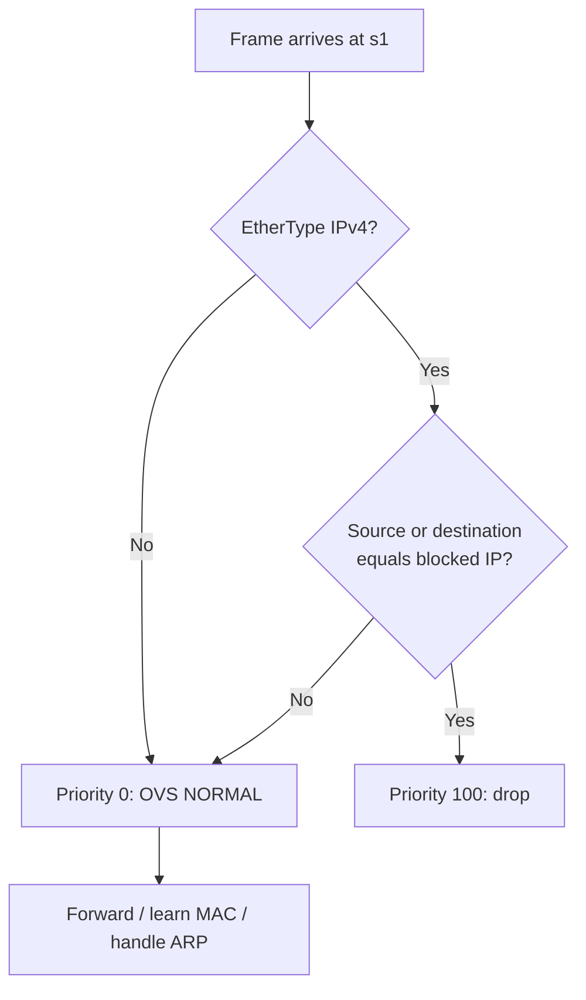
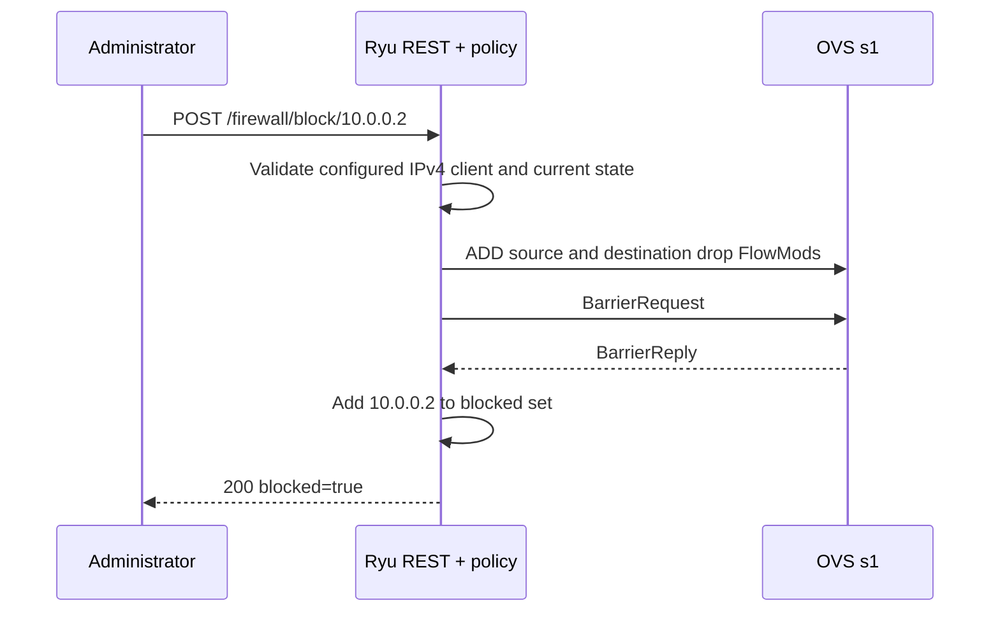

# Policy and OpenFlow theory

## Baseline forwarding

On connection, the controller accepts only datapath ID 1. It removes stale firewall rules bearing its reserved cookie prefix, installs a priority-0 catch-all `OUTPUT:NORMAL` rule, reapplies current block policies, and issues a barrier. OVS handles ordinary L2 forwarding, including ARP. All three hosts should communicate before any block policy is applied.

OpenFlow chooses the highest-priority matching flow. With no block rules, the priority-0 normal-forwarding rule matches traffic. Blocking `10.0.0.2` adds these priority-100 entries:

| Match | Priority | Action | Purpose |
|---|---:|---|---|
| `eth_type=0x0800, ipv4_src=10.0.0.2` | 100 | none (drop) | Stops h2-originated IPv4 packets |
| `eth_type=0x0800, ipv4_dst=10.0.0.2` | 100 | none (drop) | Stops IPv4 packets addressed to h2 |
| all packets | 0 | `NORMAL` | L2 forwarding for everything else |

The reference prototype's **source-only** rule would let an h1-to-h2 echo request reach h2, although h2's reply would be dropped. That can make ping fail while still permitting inbound packets. This design installs source and destination rules so both directions of IPv4 communication involving h2 are blocked, matching the requested selective-block behavior. The two rules use unique cookies and are removed with `DELETE_STRICT`, preserving the normal-forwarding rule.

ARP is not IPv4 and is still forwarded. A host may therefore resolve h2's MAC address even when IPv4 ping and TCP/UDP packets to or from h2 are dropped. The policy does not address IPv6 or other EtherTypes. It matches IP addresses rather than authenticated host identity, so it does not prevent IP spoofing.

## Dynamic update sequence

Unblocking follows the same sequence with exact flow deletion, followed by removal from the policy set. The app retains the desired policy across a switch disconnect and replays it when DPID 1 reconnects. On controller restart, its cookie-based cleanup removes stale rules from the prior process.

A barrier confirms processing order, not independent inspection of packet forwarding. FlowMod errors are logged and cause HTTP 503 when correlated with a pending update. An error or timeout may leave partially applied flows; inspect `ovs-ofctl` and reconnect the switch to trigger full reconciliation. The integration runner explicitly checks OVS after each update.

## REST contract

| Request | Response on success | Failure cases |
|---|---|---|
| `GET /firewall/blocked` | JSON list and switch status | — |
| `POST /firewall/block/{ip}` | `200`, selected IP blocked | `400` invalid/outside/unconfigured, `409` duplicate, `503` no switch or failed update |
| `POST /firewall/unblock/{ip}` | `200`, selected IP unblocked | `400` invalid/outside/unconfigured, `404` absent, `503` no switch or failed update |

Only the three configured host addresses are accepted. REST is bound to loopback and has no authentication; it is an isolated lab interface.
