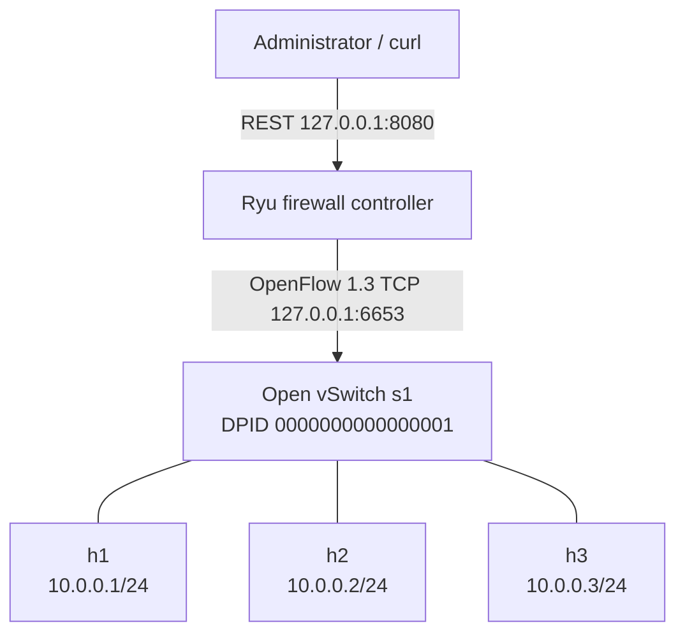
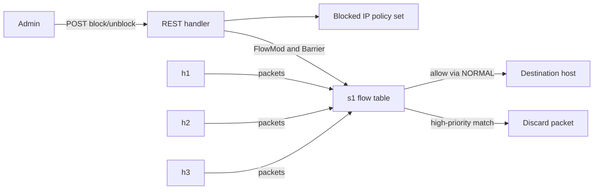

# Topology and architecture

The topology has one L2 broadcast domain, one OVS bridge, and three Mininet network namespaces. All hosts use `10.0.0.0/24`, so no IP router is needed. Host-to-host communication first uses ARP to discover destination MAC addresses, then exchanges IPv4 frames through `s1`.

| Node | Address or endpoint | Purpose |
|---|---|---|
| h1 | 10.0.0.1/24 | Client 1, unaffected test source |
| h2 | 10.0.0.2/24 | Client 2, block target |
| h3 | 10.0.0.3/24 | Client 3, unaffected peer |
| s1 | DPID 1, OpenFlow 1.3 | Performs forwarding and enforces drops |
| Ryu | 127.0.0.1:6653 | Central OpenFlow controller |
| REST | 127.0.0.1:8080 | Local administrator interface |

The Mininet topology is defined in [`topology.py`](../dynamic-firewall/topology.py). Ryu's app is [`firewall_controller.py`](../dynamic-firewall/firewall_controller.py). The controller's default priority-0 flow outputs to OVS `NORMAL`, which uses OVS's normal L2 learning and forwarding. The controller does not need a Packet-In for every allowed packet. A higher-priority match for the blocked IP overrides the default forwarding behavior.

## Control and data paths

The REST list is controller policy state. The OpenFlow table is the enforcement state. A successful change waits for an OpenFlow barrier reply before the controller updates the list. The real-network integration test also reads the switch table and checks ping results, since a controller response alone cannot prove packet blocking.
